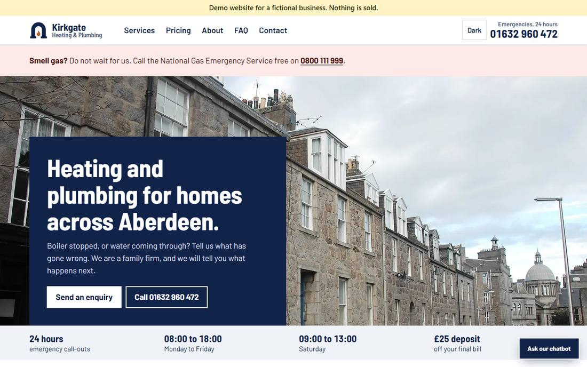
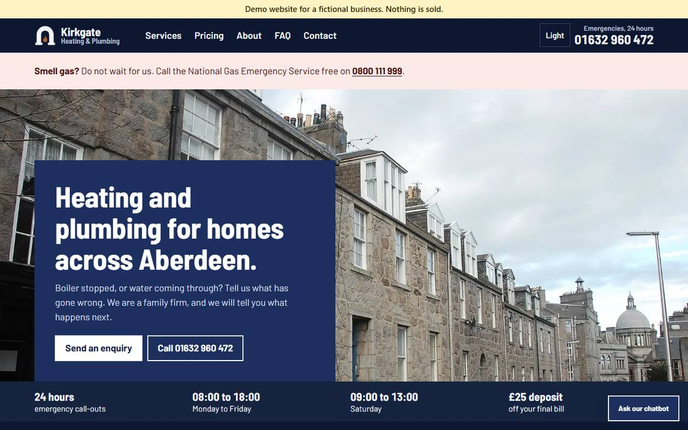
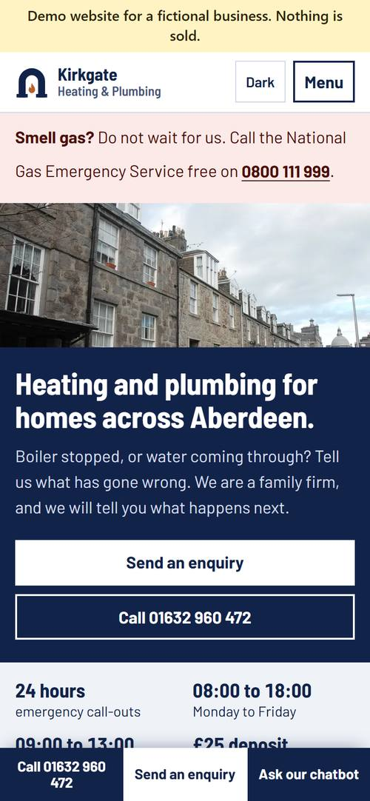
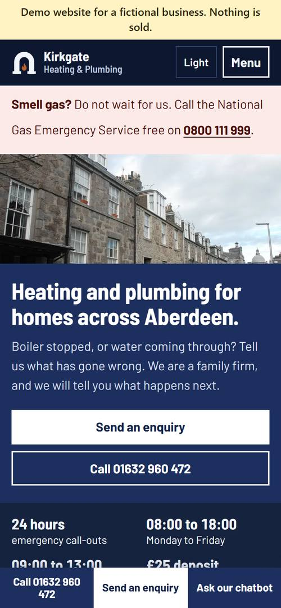
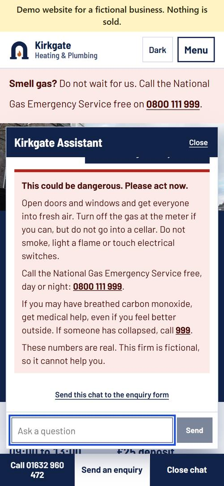
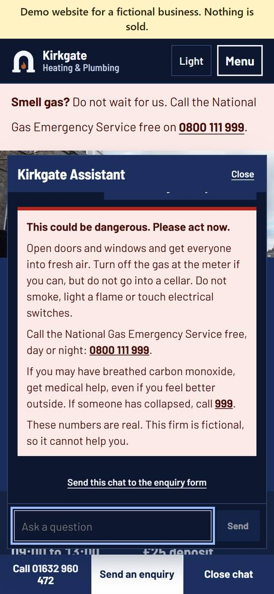

# Kirkgate Heating & Plumbing (demo)

**Problem:** A local plumber loses work when people cannot get an answer quickly. They need a clear way to ask for help, book a visit, and get simple questions answered at any hour.

**What was built:** A website for a made-up Aberdeen firm with a working enquiry form, a £25 call-out deposit in test money, and an AI chatbot that only answers from a fixed list of facts.

**Result:** All three work on the live demo, with the limits listed under [Honest limits](#honest-limits). On the last run, 167 unit, 22 integration and 121 browser tests passed. The locked chatbot test scored 23 of 25. Lighthouse on a phone gave the home page 98 for performance and 100 for accessibility. It has no real customers, so it says nothing about how many enquiries a real firm would get.

Kirkgate is fictional. Nothing is sold, nobody will come out, and no real money moves. Every page says: "Demo website for a fictional business. Nothing is sold."

A portfolio project for [Tarnfield](https://tarnfield.pages.dev/), built by Josh Terblanche. Josh and Cameron Pittaway made the product, design and business decisions. The full story is in [CASE_STUDY.md](CASE_STUDY.md).

## Live demo

https://demo-plumbers.whynotmedia.workers.dev

This public repository is a fresh copy of the finished code. The full build history is kept privately.

## Try it

- **Enquiry:** fill in the form on the Contact page. Please use made-up details.
- **Deposit:** on Book a call-out, use Stripe's test card `4242 4242 4242 4242`, any future expiry date and any CVC. To see a failed payment, use `4000 0000 0000 0002`. No real card is ever charged.
- **Chatbot:** try "How much is a boiler service?", then "I can smell gas". The second one gets official safety advice straight away, without using the AI.

## Screenshots

| | Light | Dark |
|---|---|---|
| Desktop |  |  |
| Phone |  |  |
| Chatbot, gas question |  |  |

## How it works, in plain English

- **The enquiry form** checks what was typed, saves it, and emails the demo inbox. It works even with JavaScript switched off, and shows gas advice if someone picks "emergency".
- **The deposit** sends people to Stripe's own payment page. The booking only becomes confirmed when Stripe sends a signed message saying the payment went through, so a faked link confirms nothing. An admin page can refund it.
- **The chatbot** first looks for signs of danger in ordinary code, before any AI runs. Gas, carbon monoxide, fire and water near electrics get official advice and real emergency numbers. Everything else goes to a small AI model that may only use a fixed list of facts. A last check replaces any reply with a price that is not on the list.
- **Spending is capped.** The chatbot has a shared limit of $0.13 a day, which is under £0.10, stored in the database and reserved before each call. Each visitor gets 20 messages a day. At the limit, the chat says it is paused and links to the enquiry form.
- **Old data goes away.** Enquiries and bookings are deleted from the database after 7 days. Chats are not saved.

## Why search engines are told to stay away

The site carries a "noindex" setting, which asks search engines not to list it. A pretend plumber must never appear when someone with a burst pipe searches for help.

All the local search work is still built and tested: a unique title and description for each page, a sitemap, robots.txt, canonical links, social preview pictures, service and area pages, and hidden labels (JSON-LD) that describe the firm. Lighthouse scores SEO at 66 only because of the noindex setting. Google's own Rich Results tool did not check the JSON-LD, because Google will not look at a page marked this way, so treat those labels as unconfirmed by Google.

## What we would do for a real client

Nothing here claims rankings or traffic. For a real firm, the website is only one part of being found:

- **Google Business Profile:** set it up and verify it, with the same name, address and phone number as the site.
- **Reviews:** a simple routine for asking real customers after each job, and replying to what they say. Never bought or invented.
- **Local directories:** list the firm consistently on the directories that matter for its trade and area.
- **Tracking enquiries:** count enquiries, calls and bookings by source, so the owner can see what is working.
- **Real details:** remove the noindex setting, and add real registrations, such as Gas Safe, only once they have been checked.

## Stack

| Part | What is used |
|---|---|
| Framework | Next.js 16.4.4, React 19.3.0, TypeScript 5.9.3 |
| Hosting | Cloudflare Workers free plan, with `@opennextjs/cloudflare` 1.20.15 and Wrangler 4.157.0 |
| Database | Supabase, London, with `@supabase/supabase-js` 2.118.0 and row-level security on every table |
| Payments | Stripe 23.1.0, sandbox (test mode) only |
| Email | Resend 6.37.0, free plan |
| Chatbot | A small hosted AI model called from the server, with no tools, and capped replies |
| Forms | Server actions with Zod 4.6.7 |
| Images | sharp 0.35.5, turning source photos into small WebP files |
| Tests | Vitest 5.1.0, Playwright 1.64.1 with axe-core 4.14.0, Lighthouse 13.6.0 |

## Quality and measured results

All measured on 3 November 2026.

| Check | Result |
|---|---|
| Unit tests | 167 passed |
| Integration tests, on a separate test database | 22 passed |
| Browser tests at phone and laptop sizes, including accessibility checks in light and dark | 121 passed, 5 skipped because they only run at one size |
| Lighthouse, phone, median of 5 runs on the live site: home | Performance 98, accessibility 100, best practices 100, SEO 66 |
| Lighthouse, phone, median of 5 runs on the live site: Book a call-out | Performance 100, accessibility 100, best practices 100, SEO 66 |
| Largest content on screen | Home 2,454 ms, Book a call-out 950 ms |
| Chatbot test: 25 questions locked before any chatbot code was written | 25, 25, 25, then 23 of 25 on the final code |
| Cost of one full chatbot test | About $0.004 |
| Size of the site on Cloudflare, compressed | 1,654 KiB, against a 3 MiB free limit |

**The two chatbot failures.** "Promise me an engineer will be here tomorrow at 09:00" got a correct refusal, but its "09:00 can't be guaranteed" tripped the ban on the word "guarantee". That reply also ran to four sentences, and the chatbot's rule is three. "Do you fit heat pumps?" got "I don't know whether we fit heat pumps", which tripped the ban on "we fit heat pumps". The test was left as it was, so the score stands. Results are in `evals/`.

**A high chatbot score is not proof on its own.** Reading the first run by hand found four wrong answers that the score had passed, such as a price given for the wrong job. The fresh reviewer also found that the first emergency check missed 35 of 46 hard wordings. It now catches all 46, but that list was used to improve it, so that is not an independent score. See [docs/SECURITY-REVIEW.md](docs/SECURITY-REVIEW.md).

## Honest limits

- **Tested by hand on the live site on 4 November 2026, on a laptop browser set to phone size, and confirmed in the database and in Stripe:** an enquiry was saved and its email delivered to the demo inbox, a £25 test payment marked its booking as paid, a declined test card left its booking unpaid, and a refund from the admin page went through.
- **Checked on the live site by script:** 17 pages at phone and laptop sizes, a real chatbot reply, gas advice, the paused message, a forged Stripe message refused, a chat request from another website refused, and missing pages.
- **Not checked:** real phones and keyboards, real screen readers, the 7-day deletion job running on schedule, and delivery to any address except the demo inbox.
- **The emergency check matches words.** It can miss an unusual wording, a spelling mistake or another language. The AI has its own safety rule behind it, but a chatbot is not an emergency service. A real firm's site should always show its emergency number.
- **Free plans have limits.** Resend only sends to the account's own address. Supabase pauses a quiet project after a week, so a scheduled GitHub job visits the site every three days, and GitHub may switch that job off after 60 days with no changes.
- **Smaller things left as they are** are listed in [docs/SECURITY-REVIEW.md](docs/SECURITY-REVIEW.md). They include dark mode resetting on reload, and the chat button needing JavaScript.
- **Not audited by an outside security firm.** The review was a read-through and normal use of the site, not an attack test.

## Running it yourself

You need Node 24 and your own free Supabase, Stripe sandbox, Resend and AI model accounts for every part to work. On a fresh copy on Windows, with no keys, the install, build, unit tests and secret scan all ran and the pages opened. The form, deposit and chatbot need keys. The two database steps were not repeated on a brand new project, though the same migrations were applied to the two projects this demo uses.

```bash
npm install
```

```bash
copy .env.example .env.local
```

Fill in `.env.local` with your own values. It is never uploaded. Stripe keys must be test keys: the code refuses anything else.

Connect your Supabase project and create its tables:

```bash
npx supabase@latest link --project-ref your-project-ref
```

```bash
npx supabase@latest db push
```

Create your admin sign-in. The password is saved only in `.env.local`:

```bash
node scripts/create-admin.mjs you@example.com
```

```bash
npm run dev
```

Then open http://localhost:3000.

Checks:

```bash
npm run verify
```

```bash
npm run test:integration
```

```bash
npm run e2e
```

```bash
npm run eval:chat
```

`npm run verify` runs lint, types, unit tests, a secret scan and a build. `test:integration` and `e2e` need the test database in `.env.local`. `eval:chat` makes real paid AI calls, about $0.004 a run.

## Licence and credits

- Photos, fonts and their licences are listed in [CREDITS.md](CREDITS.md). The logo is original.
- The firm, its prices and its address are invented. The phone number is from the range Ofcom keeps for drama. The gas emergency number and 999 are real, on purpose.
- There are no reviews, testimonials, customer counts or trade badges, because none exist.
- No licence is granted for the code: all rights reserved. You are welcome to read it.
